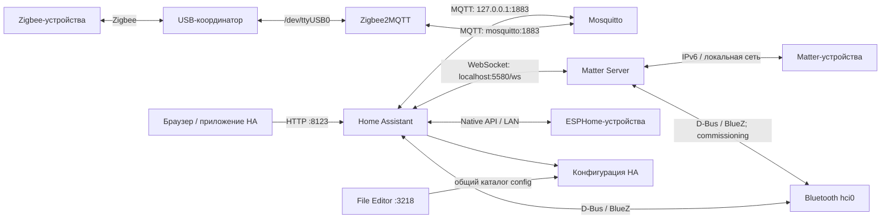

# Архитектура Home Assistant

Публичный пример конфигурации Home Assistant Container и инструкция по обслуживанию. Адреса из `192.0.2.0/24`, пользователь `hauser`, имя `ha-server` и пути ниже — примеры: замените их своими значениями перед выполнением команд. Реальные адреса, пароли, ключи и рабочие данные в репозиторий не входят.

## Оглавление

- [Сервер и локальная сеть](#сервер-и-локальная-сеть)
- [Установка и настройка Docker](#установка-и-настройка-docker)
  - [Подготовка пакетов](#подготовка-пакетов)
  - [Подключение репозитория и установка Docker](#подключение-репозитория-и-установка-docker)
  - [Доступ пользователя к Docker](#доступ-пользователя-к-docker)
  - [Настройка зеркал Docker Hub](#настройка-зеркал-docker-hub)
  - [Применение настроек и проверка](#применение-настроек-и-проверка)
- [Подготовка и первый запуск](#подготовка-и-первый-запуск)
  - [Копирование файлов на сервер](#копирование-файлов-на-сервер)
  - [Переменные основного стека](#переменные-основного-стека)
  - [Рабочие каталоги и Mosquitto](#рабочие-каталоги-и-mosquitto)
  - [Первый запуск сервисов](#первый-запуск-сервисов)
- [Сервисы и связи](#сервисы-и-связи)
  - [Zigbee и MQTT](#zigbee-и-mqtt)
  - [Matter и Bluetooth](#matter-и-bluetooth)
    - [Включение интеграции Matter](#включение-интеграции-matter)
    - [Ручная загрузка сертификатов при недоступности DCL из РФ](#ручная-загрузка-сертификатов-при-недоступности-dcl-из-рф)
    - [Перезапуск Matter](#перезапуск-matter)
    - [Логи Matter](#логи-matter)
    - [Пересоздание контейнера Matter с сохранением устройств](#пересоздание-контейнера-matter-с-сохранением-устройств)
    - [Полный сброс Matter](#полный-сброс-matter)
  - [Прямые интеграции HA](#прямые-интеграции-ha)
- [Хранение данных](#хранение-данных)
  - [Перенос хранилища Matter](#перенос-хранилища-matter)
- [Известные особенности текущей конфигурации](#известные-особенности-текущей-конфигурации)
- [Инструменты сервера](#инструменты-сервера)
- [Автозапуск после перезагрузки](#автозапуск-после-перезагрузки)
- [Обслуживание](#обслуживание)
  - [Обновление существующей установки](#обновление-существующей-установки)
- [Проверка перед публикацией](#проверка-перед-публикацией)

## Сервер и локальная сеть

Пример рассчитан на Raspberry Pi с Debian 13 (trixie), Docker Engine и Docker Compose. Home Assistant запускается как **Home Assistant Container**, без отдельного Supervisor.

| Параметр | Пример |
| --- | --- |
| Имя хоста | `ha-server` |
| Рабочий каталог на сервере | `/home/hauser/homeassistant` |
| SSH | `ssh hauser@192.0.2.10` |
| Веб-интерфейс HA | <http://192.0.2.10:8123> |
| Шлюз локальной сети | `192.0.2.1` |
| Ethernet | `eth0`, `192.0.2.10/24` |
| Wi-Fi | `wlan0`, `192.0.2.11/24` |

Это условные адреса для документации. Выберите реальные интерфейсы, маршруты и адреса своей сети; для Matter нужен IPv6 в локальной сети. Интерфейс Matter и индекс Bluetooth-адаптера задаются в локальном `.env`.

Локальная копия `docker-compose.yml` сама по себе не меняет конфигурацию работающего сервера. Перед применением скопируйте её в свой рабочий каталог и проверьте параметры.

Для File Editor предусмотрена встроенная авторизация через `HC_USERNAME` и `HC_PASSWORD`; HTTP-соединение при этом не шифруется. Создание `.env` и рабочих файлов описано в разделе [подготовки и первого запуска](#подготовка-и-первый-запуск). Cloud Commander и Uptime Kuma в примере отключены: их определения закомментированы. Для администрирования предусмотрены Portainer и Cockpit, подробнее в [tools/README.md](tools/README.md).

## Установка и настройка Docker

Команды рассчитаны на новую установку Docker Engine на Debian 13 (trixie) и выполняются на Raspberry Pi под обычным пользователем с доступом к `sudo`. Порядок установки: [документация Docker для Debian](https://docs.docker.com/engine/install/debian/). Исходный материал: [статья об установке Docker](https://ru.linux-console.net/?p=39870).

### Подготовка пакетов

```bash
sudo apt update
sudo apt install ca-certificates curl gnupg openssl nano
```

Пакет `gnupg` нужен для `gpg`, `nano` — для редактирования локальных настроек, `openssl` — для создания пароля Portainer по инструкции инструментов. Команды SSH/SCP ниже предполагают, что SSH-сервер Raspberry Pi уже доступен.

### Подключение репозитория и установка Docker

Добавьте ключ Docker и репозиторий для `trixie`:

```bash
sudo install -d -m 755 /usr/share/keyrings
curl -fsSL https://download.docker.com/linux/debian/gpg | sudo gpg --dearmor -o /usr/share/keyrings/docker.gpg
sudo chmod a+r /usr/share/keyrings/docker.gpg

echo "deb [arch=$(dpkg --print-architecture) signed-by=/usr/share/keyrings/docker.gpg] https://download.docker.com/linux/debian trixie stable" | sudo tee /etc/apt/sources.list.d/docker.list > /dev/null

sudo apt update
sudo apt install docker-ce docker-ce-cli containerd.io docker-buildx-plugin docker-compose-plugin
```

Включите автозапуск Docker, запустите службу и проверьте её состояние и наличие Compose:

```bash
sudo systemctl enable --now docker
sudo systemctl is-active docker
sudo docker compose version
```

Состояние службы должно быть `active`. Для работы с Compose используется команда `docker compose`.

### Доступ пользователя к Docker

Добавьте текущего пользователя в группу `docker`:

```bash
sudo usermod -aG docker "${USER}"
```

Права вступят в силу после полного выхода из SSH-сеанса и повторного подключения либо после перезагрузки устройства. Для применения в текущем терминале можно выполнить `newgrp docker`. См. [настройку доступа в документации Docker](https://docs.docker.com/engine/install/linux-postinstall/).

### Настройка зеркал Docker Hub

Откройте конфигурацию Docker:

```bash
sudo install -d -m 755 /etc/docker
sudo nano /etc/docker/daemon.json
```

Если файла ещё нет, создайте его со следующим содержимым. В существующем файле добавьте или обновите только `registry-mirrors`, сохранив остальные параметры и корректный синтаксис JSON:

```json
{
  "registry-mirrors": [
    "https://mirror.gcr.io",
    "https://docker.m.daocloud.io",
    "https://dockerhub.timeweb.cloud"
  ]
}
```

Адреса зеркал указаны в документации [Google Cloud](https://cloud.google.com/artifact-registry/docs/pull-cached-dockerhub-images), [DaoCloud](https://github.com/DaoCloud/public-image-mirror#加速-docker) и [Timeweb Cloud](https://dockerhub.timeweb.cloud/). Это пример списка; доступность зеркал и нужных образов зависит от сети и ограничений провайдеров.

Параметр `registry-mirrors` применяется к [Docker Hub](https://docs.docker.com/docker-hub/image-library/mirror/). Образы Home Assistant и Matter Server из `ghcr.io` продолжают загружаться из своего реестра.

### Применение настроек и проверка

Перед перезапуском проверьте конфигурацию:

```bash
sudo dockerd --validate --config-file=/etc/docker/daemon.json
```

При результате `configuration OK` перезапустите Docker. Перезапуск на работающем сервере может прервать работу контейнеров.

```bash
sudo systemctl restart docker
sudo systemctl is-active docker
```

Команда `sudo systemctl daemon-reload` нужна перед перезапуском, если изменялись unit-файлы systemd или их overrides. Для изменения только `daemon.json` достаточно перезапуска Docker. Проверка конфигурации описана в [справочнике `dockerd`](https://docs.docker.com/reference/cli/dockerd/#daemon-configuration-file).

При необходимости перезагрузите устройство; это также применит членство пользователя в группе `docker`:

```bash
sudo reboot
```

После повторного подключения проверьте доступ без `sudo`, список зеркал в разделе `Registry Mirrors` и загрузку тестового образа:

```bash
docker info
docker compose version
docker run --rm hello-world
```

Успешный запуск `hello-world` проверяет загрузку и запуск контейнера; список `Registry Mirrors` показывает применённую конфигурацию, но сам по себе не подтверждает доступность каждого зеркала.

## Подготовка и первый запуск

В репозитории хранятся публичные шаблоны. Рабочие `.env`, конфигурации интеграций, пароли, сертификаты и базы создаются на сервере по шагам ниже и исключены из Git. На существующей установке сохраните свои рабочие файлы и выполните только необходимые шаги; не создавайте новую Zigbee- или Matter-сеть поверх действующей.

### Копирование файлов на сервер

Следующий блок выполняется **на компьютере, в корне репозитория**. Если репозиторий уже находится на Raspberry Pi в рабочем каталоге, пропустите копирование.

```bash
ssh hauser@192.0.2.10 'mkdir -p /home/hauser/homeassistant/examples /home/hauser/homeassistant/system'
scp docker-compose.yml .env.example .gitignore readme.md hauser@192.0.2.10:/home/hauser/homeassistant/
scp examples/mosquitto.conf.example hauser@192.0.2.10:/home/hauser/homeassistant/examples/
scp system/autostart.sh hauser@192.0.2.10:/home/hauser/homeassistant/system/
```

Далее подключитесь к Raspberry Pi:

```bash
ssh hauser@192.0.2.10
```

Остальные команды раздела выполняются **в SSH-сеансе на Raspberry Pi**. В примерах основной стек лежит в `/home/hauser/homeassistant`. Конфигурации инструментов копируются отдельно по [tools/README.md](tools/README.md#копирование-конфигурации-на-сервер).

### Переменные основного стека

Создайте `.env` из существующего в репозитории [.env.example](.env.example). Команда сохраняет уже существующий `.env`:

```bash
cd /home/hauser/homeassistant
[ -e .env ] || (umask 077; cp .env.example .env)
chmod 600 .env
nano .env
```

| Переменная в корневом `.env` | Назначение | Значение в шаблоне |
| --- | --- | --- |
| `ZIGBEE_ADAPTER_PATH` | Путь к координатору на хосте, желательно `/dev/serial/by-id/...` | `/dev/ttyUSB0` |
| `MATTER_PRIMARY_INTERFACE` | Сетевой интерфейс Matter | `wlan0` |
| `MATTER_BLUETOOTH_ADAPTER` | Индекс адаптера BlueZ: `hci0` → `0`, `hci1` → `1` | `0` |
| `HC_USERNAME` | Логин File Editor | `admin` |
| `HC_PASSWORD` | Уникальный пароль File Editor | Пусто; заполнить обязательно |
| `CLOUDCMD_USERNAME`, `CLOUDCMD_PASSWORD` | Учётные данные отключённого Cloud Commander | Нужны только при включении сервиса |

Имена интерфейсов, Bluetooth-адаптеров и путь координатора посмотрите на сервере:

```bash
ip -br link
ls /sys/class/bluetooth/
ls -l /dev/serial/by-id/
```

В `.env` укажите существующие в вашей системе значения. Если каталога `/dev/serial/by-id/` нет, сначала подключите координатор и проверьте его обнаружение. Если нет `hci*`, проверьте наличие и доступность Bluetooth-адаптера. Пароли можно заключать в одинарные кавычки, чтобы символ `$` не интерпретировался Compose. При пустых `HC_USERNAME` или `HC_PASSWORD` Compose выдаст ошибку.

На уже настроенном сервере после изменения `.env` нужно пересоздать соответствующий контейнер; простой `docker restart` не перечитывает переменные Compose. Для новой установки сначала выполните следующие разделы подготовки. Например, после изменения параметров Matter на работающем сервере:

```bash
cd /home/hauser/homeassistant
docker compose config --quiet
docker compose up -d --no-deps matter-server
```

После изменения `ZIGBEE_ADAPTER_PATH` пересоздайте `zigbee2mqtt`, после изменения `HC_USERNAME` или `HC_PASSWORD` — `hass-configurator` той же командой с нужным именем сервиса.

### Рабочие каталоги и Mosquitto

Команды выполняются на сервере из каталога основного стека. Файл `mosquitto.conf` создаётся из [публичного шаблона](examples/mosquitto.conf.example); существующая конфигурация сохраняется:

```bash
cd /home/hauser/homeassistant
mkdir -p config hass-configurator-config zigbee2mqtt-data matter-data
mkdir -p mosquitto/config mosquitto/data mosquitto/log
[ -e mosquitto/config/mosquitto.conf ] || cp examples/mosquitto.conf.example mosquitto/config/mosquitto.conf
```

На **новой установке** создайте пользователя MQTT, например `mqttuser`. Следующая команда спросит пароль интерактивно; используйте его позже в Zigbee2MQTT и интеграции MQTT Home Assistant. Параметр `-c` создаёт новый файл паролей, поэтому команда выполняется только при его отсутствии:

```bash
cd /home/hauser/homeassistant
if [ ! -e mosquitto/config/passwd ]; then
  docker compose run --rm --no-deps --user 0:0 mosquitto mosquitto_passwd -c /mosquitto/config/passwd mqttuser
fi
sudo chown -R 1883:1883 mosquitto
sudo chmod 600 mosquitto/config/passwd
```

В официальном образе Mosquitto используется UID/GID `1883`; при выборе другого образа проверьте его пользователя. Для добавления учётной записи в существующий файл используйте `mosquitto_passwd` без `-c`, предварительно сохранив резервную копию. В Git пароль, его хеш и рабочая конфигурация не добавляются. Параметры брокера описаны в [справочнике Mosquitto](https://mosquitto.org/man/mosquitto-conf-5.html).

### Первый запуск сервисов

На сервере сначала проверьте Compose и запустите брокер, HA и редактор:

```bash
cd /home/hauser/homeassistant
docker compose config --quiet
docker compose up -d mosquitto homeassistant hass-configurator
docker compose ps
```

Home Assistant создаст рабочие файлы в `config/` при первом запуске. Откройте `http://АДРЕС_СЕРВЕРА:8123`, создайте свою учётную запись и добавьте интеграцию MQTT: брокер `127.0.0.1`, порт `1883`, пользователь и пароль из предыдущего шага. File Editor доступен на порту `3218` с учётными данными из `.env`; он видит тот же `config/`, а собственные настройки хранит в `hass-configurator-config/`.

Затем запустите Zigbee2MQTT с подключённым координатором и заполненным `ZIGBEE_ADAPTER_PATH`:

```bash
cd /home/hauser/homeassistant
docker compose up -d --no-deps zigbee2mqtt
docker compose logs --tail 50 zigbee2mqtt
```

На новой установке откройте порт `8080` и пройдите [первоначальную настройку Zigbee2MQTT](https://www.zigbee2mqtt.io/guide/getting-started/#onboarding): MQTT-сервер `mqtt://mosquitto:1883`, созданные учётные данные MQTT, порт координатора **в контейнере** `/dev/ttyUSB0` и драйвер своего координатора, например `zstack`. Включите frontend на `8080` и интеграцию Home Assistant. Мастер создаёт `zigbee2mqtt-data/configuration.yaml` локально; в репозитории этого рабочего файла нет. На существующей установке используйте её конфигурацию и данные сети.

Matter запускается отдельно после [подготовки сертификатов](#ручная-загрузка-сертификатов-при-недоступности-dcl-из-рф), поскольку в приведённом Compose доступ к DCL заблокирован. Проверьте `MATTER_PRIMARY_INTERFACE` и `MATTER_BLUETOOTH_ADAPTER` до его запуска. После запуска сервера [добавьте интеграцию Matter в HA](#включение-интеграции-matter).

## Сервисы и связи



| Контейнер | Образ | Сеть и доступ | Функция |
| --- | --- | --- | --- |
| `homeassistant` | `ghcr.io/home-assistant/home-assistant:stable` | `host`, TCP `8123` | Интерфейс, автоматизации и интеграции HA |
| `mosquitto` | `eclipse-mosquitto:latest` | Сеть Compose; опубликован TCP `1883`, также проброшен `9001` | MQTT-брокер |
| `zigbee2mqtt` | `koenkk/zigbee2mqtt:latest` | Сеть Compose; TCP `8080` | Zigbee ↔ MQTT; [веб-интерфейс](http://192.0.2.10:8080) |
| `matter-server` | `ghcr.io/home-assistant-libs/python-matter-server:stable` | `host`, TCP `5580` | Отдельный Matter-контроллер; [веб-интерфейс](http://192.0.2.10:5580) |
| `hass-configurator` | `causticlab/hass-configurator-docker:latest` | Сеть Compose; TCP `3218`; встроенная авторизация | File Editor для каталога конфигурации HA; [веб-интерфейс](http://192.0.2.10:3218) |

Для всех пяти активных сервисов задано `restart: unless-stopped`. `homeassistant` и `zigbee2mqtt` зависят от запуска `mosquitto` через `depends_on`. Healthcheck в Compose не задан. Закомментированный Cloud Commander не запускается при `docker compose up -d`.

Теги `latest` и `stable` меняются со временем и не фиксируют версии приложений. Перед обновлением проверяйте примечания к выбранному образу и сохраняйте резервную копию рабочих данных.

### Zigbee и MQTT

Zigbee2MQTT использует драйвер `zstack`. Путь к координатору задаётся локальной переменной `ZIGBEE_ADAPTER_PATH` в `.env` и пробрасывается в контейнер как `/dev/ttyUSB0`. Выберите драйвер, соответствующий своему координатору.

Внутри Docker Zigbee2MQTT подключается к `mqtt://mosquitto`; базовая тема — `zigbee2mqtt`. Публикация MQTT discovery для Home Assistant включена. HA подключается к тому же брокеру через опубликованный порт `127.0.0.1:1883`, поскольку работает в сети хоста.

После подготовки по инструкции Mosquitto использует `listener 1883`, анонимный доступ отключён. Файл учётных записей — `/mosquitto/config/passwd` внутри контейнера. Порт `9001` проброшен в Compose, но WebSocket listener в шаблоне `mosquitto.conf.example` не настроен.

### Matter и Bluetooth

Интеграция Matter в HA подключается к `ws://localhost:5580/ws`. Текущие аргументы запуска Matter Server:

```yaml
command:
  - --storage-path
  - /data
  - --paa-root-cert-dir
  - /data/credentials
  - --ota-provider-dir
  - /data/updates
  - --primary-interface
  - ${MATTER_PRIMARY_INTERFACE:-wlan0}
  - --bluetooth-adapter
  - "${MATTER_BLUETOOTH_ADAPTER:-0}"
```

`MATTER_PRIMARY_INTERFACE` выбирает сетевой интерфейс Matter. `MATTER_BLUETOOTH_ADAPTER` задаёт индекс BlueZ: например, `0` соответствует `hci0`; номера зависят от адаптеров хоста. Служба BlueZ работает на хосте; доступ к ней оба контейнера получают через `/run/dbus`. Один адаптер может использоваться Matter Server и интеграцией Bluetooth HA. Дополнительно смонтирован `/dev/bus/usb`.

Контейнеров Thread Border Router / OTBR в текущем Compose нет.

#### Включение интеграции Matter

Home Assistant и Matter Server работают в режиме `host` на одном Raspberry Pi, поэтому HA может подключаться к серверу через `localhost`.

1. Откройте **Настройки → Устройства и службы** в Home Assistant.
2. Если появилась карточка **«Обнаружено: Matter»**, нажмите **Настроить**.
3. Если карточки нет, нажмите **Добавить интеграцию**, найдите **Matter** и выберите её.
4. Для подключения к уже запущенному серверу укажите **`ws://localhost:5580/ws`**. Если мастер предлагает использовать приложение Matter Server из Home Assistant OS, отключите этот вариант и перейдите к вводу адреса внешнего сервера.
5. Завершите настройку и убедитесь, что интеграция подключилась без ошибок.

Режим `host` позволяет обращаться к серверу по этому адресу; появление карточки автообнаружения зависит от обнаружения сервиса в сети. Порядок подключения внешнего сервера описан в [документации интеграции Matter](https://www.home-assistant.io/integrations/matter/).

#### Ручная загрузка сертификатов при недоступности DCL из РФ

В текущем Compose доступ к `on.dcl.csa-iot.org` намеренно заблокирован. Сертификаты PAA хранятся на хосте в `/home/hauser/homeassistant/matter-data/credentials/`; контейнер видит этот каталог как `/data/credentials` благодаря параметру `--paa-root-cert-dir`.

Остановите Matter Server и подготовьте каталоги на Raspberry Pi:

```bash
cd /home/hauser/homeassistant
docker compose stop matter-server
sudo mkdir -p ./matter-data/credentials
mkdir -p /home/hauser/paa-root-certs
```

Скачайте файлы сертификатов `.der` из каталога [production/paa-root-certs проекта connectedhomeip](https://github.com/project-chip/connectedhomeip/tree/master/credentials/production/paa-root-certs) через **Download raw file**. Если GitHub недоступен с Raspberry Pi, скачайте файлы на другом компьютере и передайте их по SCP/SFTP в `/home/hauser/paa-root-certs/`.

Убедитесь, что загруженные `.der` уже находятся в указанном каталоге. Скопируйте их в хранилище и создайте служебный файл `.version` только после успешного копирования:

```bash
cd /home/hauser/homeassistant
sudo cp /home/hauser/paa-root-certs/*.der ./matter-data/credentials/ &&
  printf '1\n' | sudo tee ./matter-data/credentials/.version > /dev/null
```

В [Matter Server 8.1.0](https://github.com/home-assistant-libs/python-matter-server/blob/8.1.0/matter_server/server/helpers/paa_certificates.py) каталог без `.version` считается устаревшим, и его файлы удаляются перед загрузкой сертификатов. Сохранение этого файла позволяет использовать сертификаты, добавленные вручную. Тег `stable` может указывать на другую версию: перед переносом проверьте её механизм загрузки сертификатов.

После успешного копирования запустите сервер и проверьте его журнал:

```bash
cd /home/hauser/homeassistant
docker compose up -d --no-deps matter-server
docker logs --tail 50 matter-server
```

Ошибки обращения к заблокированному DCL могут оставаться в журнале; проверьте, что сервер загрузил локальные сертификаты и запустился.

#### Перезапуск Matter

```bash
docker restart matter-server
```

Перезапуск сохраняет данные в `matter-data/` и сопряжённые устройства.

#### Логи Matter

Последние 50 строк с просмотром новых сообщений в реальном времени:

```bash
docker logs -f --tail 50 matter-server
```

Для выхода из просмотра нажмите **Ctrl+C**. Контейнер продолжит работать.

Весь доступный журнал контейнера:

```bash
docker logs matter-server
```

#### Пересоздание контейнера Matter с сохранением устройств

```bash
cd /home/hauser/homeassistant
docker compose up -d --no-deps --force-recreate matter-server
```

Compose пересоздаст только Matter Server. Каталог `matter-data/`, сертификаты и данные сопряжения сохранятся.

#### Полный сброс Matter

Команда `sudo rm -rf ./matter-data` удаляет данные Matter-контроллера, включая его ключи, сведения о сопряжённых устройствах и сертификаты. После такого сброса устройства потребуется заново добавить в Home Assistant.

Для полного сброса с возможностью восстановления остановите и удалите контейнер, затем перенесите хранилище в резервную копию:

```bash
cd /home/hauser/homeassistant
docker compose stop matter-server
docker compose rm -f matter-server

backup_dir="backups/matter-reset-$(date +%Y%m%dT%H%M%S%z)"
mkdir -p backups
mkdir -m 700 "$backup_dir"
sudo mv ./matter-data "$backup_dir/matter-data"
```

После успешного переноса создайте новое хранилище и верните в него только сертификаты. Это нужно, поскольку доступ к DCL заблокирован. Если каталога `credentials` в резервной копии нет, загрузите сертификаты по инструкции выше перед запуском сервера. Выполняйте следующие команды в том же терминале, где задана переменная `backup_dir`:

```bash
test -d "$backup_dir/matter-data/credentials" &&
  sudo mkdir -p ./matter-data &&
  sudo cp -a "$backup_dir/matter-data/credentials" ./matter-data/ &&
  printf '1\n' | sudo tee ./matter-data/credentials/.version > /dev/null &&
  docker compose up -d --no-deps matter-server
docker logs --tail 50 matter-server
```

При отсутствии резервного каталога сертификатов цепочка команд не запустит контейнер: сначала загрузите сертификаты по инструкции выше. Прежние данные контроллера сохранятся в `$backup_dir/matter-data/`; новый контейнер создаст отдельную Matter-сеть.

### Прямые интеграции HA

Помимо MQTT, Matter и Bluetooth, можно подключать ESPHome, Tasmota, мобильное приложение HA и другие локальные интеграции. Конкретные устройства, их имена, модели и идентификаторы не публикуются.

В `configuration.yaml` можно использовать `default_config`, `frontend` и подключения файлов `automations.yaml`, `scripts.yaml`, `scenes.yaml`. Реальный каталог `config/`, включая `.storage`, остаётся локальным и исключён из Git.

## Хранение данных

Пути слева указаны относительно `/home/hauser/homeassistant` на Raspberry Pi.

| Каталог на хосте | Каталог в контейнере | Содержимое |
| --- | --- | --- |
| `config/` | `/config` в HA | YAML, `.storage`, база HA и настройки интеграций |
| `config/` | `/hass-config` в File Editor | Тот же каталог конфигурации; просмотр ограничен этим путём |
| `hass-configurator-config/` | `/config` в File Editor | Настройки редактора (`settings.conf`, если используется) |
| `zigbee2mqtt-data/` | `/app/data` | Конфигурация Zigbee2MQTT и данные Zigbee-сети |
| `mosquitto/config/` | `/mosquitto/config` | Настройки брокера и файл учётных записей |
| `mosquitto/data/` | `/mosquitto/data` | Каталог для данных брокера |
| `mosquitto/log/` | `/mosquitto/log` | Каталог для файловых логов брокера |
| `matter-data/` | `/data` | Активная Matter-сеть: `chip.json`, JSON контроллера, файлы SDK, сертификаты `credentials/` и данные OTA `updates/` |
| `backups/` | Не монтируется | Приватные резервные копии Compose и рабочих данных |

HA и Zigbee2MQTT получают часовой пояс хоста через `/etc/localtime`. Учитывайте часовой пояс при сравнении журналов разных сервисов.

### Перенос хранилища Matter

Если предыдущая конфигурация сохраняла активные данные в `/root/.matter_server` внутри контейнера, перед пересозданием перенесите их в каталог `matter-data/` на хосте. В Compose уже заданы пути хранилища, сертификатов и OTA внутри `/data`.

Перед копированием остановите Matter Server и сохраните резервные копии активного хранилища, прежнего `/data` и Compose в локальном `backups/`. Сохраните файлы SDK и сертификаты, затем сверьте контрольные суммы скопированных файлов.

После запуска проверьте загрузку `/data/chip.json` без сброса конфигурации и сохранение ранее сопряжённых устройств. Ключи и идентификаторы Matter-сети не включайте в публичный отчёт. Каталог `matter-data/` исключён из Git и сохраняется при пересоздании контейнера.

## Известные особенности текущей конфигурации

1. **Доступ к DCL намеренно заблокирован в контейнере.** `extra_hosts` направляет `on.dcl.csa-iot.org` на `127.0.0.1`. Поэтому запросы сведений о производителях и новых сертификатов DCL завершаются `Connection refused`. Сохранённые сертификаты явно загружаются из `/data/credentials`.
2. **Один Bluetooth-адаптер используется двумя компонентами.** Интеграция Bluetooth HA и Matter Server обращаются к одному `hci0`; совместное использование нужно учитывать при разборе сбоев BLE.
3. **Интерфейс Matter выбирается отдельно от основного маршрута хоста.** `MATTER_PRIMARY_INTERFACE` должен указывать на существующий интерфейс с доступом к устройствам и рабочим IPv6. При ошибке `Failed to advertise records: Network is unreachable` проверьте выбранный интерфейс, его адреса и маршруты.

Эти особенности относятся к приведённому примеру. Проверяйте интерфейсы и доступность DCL в своей установке.

## Инструменты сервера

Конфигурации инструментов хранятся отдельно в [tools/README.md](tools/README.md). Для них используется пример каталога `/home/hauser/tools`: Portainer CE в собственном Compose-проекте и Cockpit как пакет Debian. Compose Uptime Kuma сохранён с закомментированным сервисом. Инструкция описывает копирование шаблонов, создание локальных файлов, настройку адресов панелей, включение мониторинга, обновление и резервное копирование. Пароли и рабочие базы в Git не сохраняются.

## Автозапуск после перезагрузки

Автозапуск обеспечивает Docker: службы `docker.service` и `containerd.service` включены при загрузке, а у всех включённых сервисов Compose задано `restart: unless-stopped`. Docker восстанавливает созданные контейнеры после перезагрузки и перезапускает их при завершении процесса. Отдельные unit-файлы systemd для контейнеров не требуются. См. [правила перезапуска Docker](https://docs.docker.com/engine/containers/start-containers-automatically/).

После подготовки рабочих конфигураций и загрузки образов выполните **на сервере**:

```bash
bash /home/hauser/homeassistant/system/autostart.sh /home/hauser/homeassistant /home/hauser/tools
```

Скрипт [system/autostart.sh](system/autostart.sh) проверяет Compose, при необходимости включает и запускает службы Docker через `sudo`, выполняет `docker compose up -d --pull never` для основного стека и Portainer, затем проверяет состояние и политику перезапуска каждого контейнера. Kuma запускается только при наличии включённых сервисов в её Compose; пустой `services: {}` пропускается. Образы скрипт не обновляет: при их отсутствии сначала выполните `docker compose pull` в соответствующем проекте.

Пути можно передать явно, как выше. Без аргументов основной каталог определяется по расположению скрипта, а `tools` ищется внутри проекта либо рядом с ним. Локальный `.env` каждого проекта имеет приоритет; если у инструмента его нет, скрипт использует общий `tools/.env`. Секреты, настройки Cockpit и рабочие данные скрипт не изменяет.

Проверка без изменений, в том числе после перезагрузки:

```bash
bash /home/hauser/homeassistant/system/autostart.sh --check /home/hauser/homeassistant /home/hauser/tools
systemctl is-enabled docker.service containerd.service
systemctl is-active docker.service containerd.service
docker ps --format 'table {{.Names}}\t{{.Status}}'
```

`running` и включённая политика перезапуска подтверждают состояние контейнера; готовность приложений проверяйте отдельно по журналам и веб-интерфейсам. Для Cockpit используется ранее настроенный `cockpit.socket`; он не входит в Docker-стек.

При `unless-stopped` контейнер, остановленный вручную через `docker stop` или `docker compose stop`, остаётся остановленным и после перезагрузки. Для возвращения в работу выполните `docker compose up -d` в его проекте либо повторно запустите скрипт без `--check`. После `docker compose down` контейнеров нет: Docker не создаёт их при загрузке, нужен новый `up -d`. Отключённые Cloud Commander и Kuma автоматически не включаются.

Для проверки полного цикла можно выполнить `sudo reboot`, дождаться доступности SSH и повторить команды проверки. Если контейнер не запустился, проверьте `journalctl -u docker.service -b`, `docker compose ps -a` и `docker compose logs --tail 100` в его каталоге. Для Zigbee проверьте наличие координатора, для панелей — доступность адреса из `TOOLS_BIND_IP`.

## Обслуживание

Команды выполняются на Raspberry Pi:

```bash
ssh hauser@192.0.2.10
cd /home/hauser/homeassistant
docker compose ps
docker compose config --quiet
docker compose logs --tail 100 homeassistant matter-server
docker compose logs --tail 100 zigbee2mqtt mosquitto
```

Для резервного копирования Matter нужно сохранять весь каталог `matter-data/`; согласованный снимок следует делать при остановленном Matter Server. Каталог `backups/` содержит приватные данные Matter-сети и доступен владельцу. PIN-коды Matter, MQTT-пароли и содержимое приватных ключей в README не сохраняются.

### Обновление существующей установки

С компьютера передавайте только публичные файлы командами из [раздела копирования](#копирование-файлов-на-сервер) и [инструкции инструментов](tools/README.md#копирование-конфигурации-на-сервер). Не копируйте поверх сервера локальные `.env`, `config/`, `matter-data/`, `zigbee2mqtt-data/`, `mosquitto/`, `data/`, `secrets/` и настройки Cockpit. Перед заменой Compose сохраните прежние файлы в приватном `backups/` на сервере.

Проверьте, что специфические параметры прежнего Compose перенесены в серверные `.env`: путь Zigbee, интерфейс и Bluetooth Matter, адрес панелей и учётные данные редактора. Compose автоматически читает `.env` из каталога проекта; общий `/home/hauser/tools/.env` для ручных команд указывайте через `--env-file` либо один раз скопируйте в `portainer/.env`, если его ещё нет. Существующий файл не перезаписывайте.

В SSH-сеансе проверьте конфигурации и загрузите образы, пока сервисы ещё работают:

```bash
cd /home/hauser/homeassistant
docker compose config --quiet
docker compose pull
cd /home/hauser/tools/portainer
if [ ! -e .env ] && [ -f ../.env ]; then
  (umask 077; cp ../.env .env)
fi
docker compose config --quiet
docker compose pull
```

Перед применением остановите оба проекта через `docker compose stop --timeout 60` в соответствующих каталогах и сделайте согласованную резервную копию основного стека и `portainer/data/` вместе с локальными настройками и секретами. Каталоги `backups/` исключите из архива; храните его с правами `600`. Если копирование не удалось, сначала верните контейнеры в работу через `docker compose start`.

Затем примените Compose, пересоздайте контейнеры с сохранением подключённых каталогов и проверьте автозапуск:

```bash
cd /home/hauser/homeassistant
docker compose up -d --pull never --force-recreate
cd /home/hauser/tools/portainer
docker compose up -d --pull never --force-recreate
bash /home/hauser/homeassistant/system/autostart.sh /home/hauser/homeassistant /home/hauser/tools
```

Проверьте HA (`8123`), Zigbee2MQTT (`8080`), File Editor (`3218`, без входа ожидается `401`), Portainer (`9443/api/status`), MQTT (`1883`) и Matter (`5580`). Сверьте журналы с состоянием до обновления и убедитесь, что прежние интеграции и устройства доступны. Данные сохраняются в прежних каталогах; для отката после миграции формата данных могут понадобиться и прежние образы, и резервная копия. Старые образы не удаляйте до окончания проверки.

## Проверка перед публикацией

Публикуйте только шаблоны, Compose-файлы, скрипты и документацию. `.gitignore` исключает `.env`, `.credentials.env`, пароли Portainer, рабочие каталоги HA/MQTT/Zigbee/Matter, настройки редактора, базы, журналы и резервные копии. Файлы `.env.example` и `.credentials.env.example` содержат только пустые или условные значения.

`.gitignore` не исключает файлы, которые уже отслеживаются Git. После подготовки нового репозитория и добавления файлов проверьте состав индекса:

```bash
git status --short --ignored
git diff --cached --name-only
git ls-files
```

В списке для публикации не должно быть файлов с рабочими данными или учётными данными. Также проверьте текст инструкции и скрипты: реальные IP/MAC/IPv6-адреса, имена устройств и идентификаторы сетей не должны попадать в примеры.

При установленном [Gitleaks](https://github.com/gitleaks/gitleaks) проверьте подготовленные изменения без вывода значений секретов:

```bash
gitleaks git --pre-commit --staged --redact --no-banner
```

Проверка относится к текущим подготовленным изменениям, а не к старой истории. Не добавляйте приватные файлы через `git add -f` и не загружайте архив всего рабочего каталога: игнорируемые файлы остаются на диске. Если секрет уже был опубликован, замените его; удаление истории не отзывает пароль или токен.
