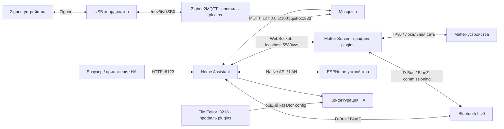

# Архитектура Home Assistant

Публичный пример конфигурации Home Assistant Container и инструкция по обслуживанию. Адреса из `192.0.2.0/24`, пользователь `hauser`, имя `ha-server` и пути ниже — примеры: замените их своими значениями перед выполнением команд. Реальные адреса, пароли, ключи и рабочие данные в репозиторий не входят.

## Оглавление

- [Сервер и локальная сеть](#сервер-и-локальная-сеть)
- [Установка и настройка Docker](#установка-и-настройка-docker)
  - [Подготовка пакетов](#подготовка-пакетов)
  - [Подключение репозитория и установка Docker](#подключение-репозитория-и-установка-docker)
  - [Доступ пользователя к Docker](#доступ-пользователя-к-docker)
  - [Настройка зеркал Docker Hub](#настройка-зеркал-docker-hub)
  - [Применение настроек и проверка](#применение-настроек-и-проверка)
- [Подготовка и первый запуск](#подготовка-и-первый-запуск)
  - [Копирование файлов на сервер](#копирование-файлов-на-сервер)
  - [Переменные основного стека](#переменные-основного-стека)
  - [Рабочие каталоги и Mosquitto](#рабочие-каталоги-и-mosquitto)
  - [Первый запуск сервисов](#первый-запуск-сервисов)
- [Сервисы и связи](#сервисы-и-связи)
  - [Zigbee и MQTT](#zigbee-и-mqtt)
  - [Matter и Bluetooth](#matter-и-bluetooth)
  - [Прямые интеграции HA](#прямые-интеграции-ha)
- [Хранение данных](#хранение-данных)
- [Известные особенности текущей конфигурации](#известные-особенности-текущей-конфигурации)
- [Плагины Home Assistant](#плагины-home-assistant)
- [Инструменты сервера](#инструменты-сервера)
- [Управление всей системой](#управление-всей-системой)
- [Автозапуск после перезагрузки](#автозапуск-после-перезагрузки)
- [Обслуживание](#обслуживание)
  - [Обновление существующей установки](#обновление-существующей-установки)
- [Проверка перед публикацией](#проверка-перед-публикацией)

## Сервер и локальная сеть

Пример рассчитан на Raspberry Pi с Debian 13 (trixie), Docker Engine и Docker Compose. Home Assistant запускается как **Home Assistant Container**, без отдельного Supervisor.

| Параметр | Пример |
| --- | --- |
| Имя хоста | `ha-server` |
| Рабочий каталог на сервере | `/home/hauser/homeassistant` |
| SSH | `ssh hauser@192.0.2.10` |
| Веб-интерфейс HA | <http://192.0.2.10:8123> |
| Шлюз локальной сети | `192.0.2.1` |
| Ethernet | `eth0`, `192.0.2.10/24` |
| Wi-Fi | `wlan0`, `192.0.2.11/24` |

Это условные адреса для документации. Выберите реальные интерфейсы, маршруты и адреса своей сети; для Matter нужен IPv6 в локальной сети. Интерфейс Matter и индекс Bluetooth-адаптера задаются в `plugins/.env`.

Локальная копия [homeassistant/docker-compose.yml](homeassistant/docker-compose.yml) сама по себе не меняет конфигурацию работающего сервера. Перед применением скопируйте её в свой рабочий каталог и проверьте параметры.

Zigbee2MQTT, File Editor и Matter Server вынесены в [plugins/](plugins/README.md) и по умолчанию отключены. File Editor использует встроенную авторизацию; HTTP-соединение не шифруется. Yandex Smart Home устанавливается через [HACS](plugins/yandex-smart-home/README.md). Cloud Commander в стек не входит, Uptime Kuma отключена. Для администрирования предусмотрены Portainer и Cockpit, подробнее в [tools/README.md](tools/README.md).

## Установка и настройка Docker

Команды рассчитаны на новую установку Docker Engine на Debian 13 (trixie) и выполняются на Raspberry Pi под обычным пользователем с доступом к `sudo`. Порядок установки: [документация Docker для Debian](https://docs.docker.com/engine/install/debian/). Исходный материал: [статья об установке Docker](https://ru.linux-console.net/?p=39870).

### Подготовка пакетов

```bash
sudo apt update
sudo apt install ca-certificates curl gnupg openssl nano python3
```

Пакет `gnupg` нужен для `gpg`, `nano` — для редактирования локальных настроек, `openssl` — для создания пароля Portainer по инструкции инструментов, `python3` — для управления профилями плагинов (только стандартная библиотека). Команды SSH/SCP ниже предполагают, что SSH-сервер Raspberry Pi уже доступен.

### Подключение репозитория и установка Docker

Добавьте ключ Docker и репозиторий для `trixie`:

```bash
sudo install -d -m 755 /usr/share/keyrings
curl -fsSL https://download.docker.com/linux/debian/gpg | sudo gpg --dearmor -o /usr/share/keyrings/docker.gpg
sudo chmod a+r /usr/share/keyrings/docker.gpg

echo "deb [arch=$(dpkg --print-architecture) signed-by=/usr/share/keyrings/docker.gpg] https://download.docker.com/linux/debian trixie stable" | sudo tee /etc/apt/sources.list.d/docker.list > /dev/null

sudo apt update
sudo apt install docker-ce docker-ce-cli containerd.io docker-buildx-plugin docker-compose-plugin
```

Включите автозапуск Docker, запустите службу и проверьте её состояние и наличие Compose:

```bash
sudo systemctl enable --now docker
sudo systemctl is-active docker
sudo docker compose version
```

Состояние службы должно быть `active`. Для работы с Compose используется команда `docker compose`.

### Доступ пользователя к Docker

Добавьте текущего пользователя в группу `docker`:

```bash
sudo usermod -aG docker "${USER}"
```

Права вступят в силу после полного выхода из SSH-сеанса и повторного подключения либо после перезагрузки устройства. Для применения в текущем терминале можно выполнить `newgrp docker`. См. [настройку доступа в документации Docker](https://docs.docker.com/engine/install/linux-postinstall/).

### Настройка зеркал Docker Hub

Откройте конфигурацию Docker:

```bash
sudo install -d -m 755 /etc/docker
sudo nano /etc/docker/daemon.json
```

Если файла ещё нет, создайте его со следующим содержимым. В существующем файле добавьте или обновите только `registry-mirrors`, сохранив остальные параметры и корректный синтаксис JSON:

```json
{
  "registry-mirrors": [
    "https://mirror.gcr.io",
    "https://docker.m.daocloud.io",
    "https://dockerhub.timeweb.cloud"
  ]
}
```

Адреса зеркал указаны в документации [Google Cloud](https://cloud.google.com/artifact-registry/docs/pull-cached-dockerhub-images), [DaoCloud](https://github.com/DaoCloud/public-image-mirror#加速-docker) и [Timeweb Cloud](https://dockerhub.timeweb.cloud/). Это пример списка; доступность зеркал и нужных образов зависит от сети и ограничений провайдеров.

Параметр `registry-mirrors` применяется к [Docker Hub](https://docs.docker.com/docker-hub/image-library/mirror/). Образы Home Assistant и Matter Server из `ghcr.io` продолжают загружаться из своего реестра.

### Применение настроек и проверка

Перед перезапуском проверьте конфигурацию:

```bash
sudo dockerd --validate --config-file=/etc/docker/daemon.json
```

При результате `configuration OK` перезапустите Docker. Перезапуск на работающем сервере может прервать работу контейнеров.

```bash
sudo systemctl restart docker
sudo systemctl is-active docker
```

Команда `sudo systemctl daemon-reload` нужна перед перезапуском, если изменялись unit-файлы systemd или их overrides. Для изменения только `daemon.json` достаточно перезапуска Docker. Проверка конфигурации описана в [справочнике `dockerd`](https://docs.docker.com/reference/cli/dockerd/#daemon-configuration-file).

При необходимости перезагрузите устройство; это также применит членство пользователя в группе `docker`:

```bash
sudo reboot
```

После повторного подключения проверьте доступ без `sudo`, список зеркал в разделе `Registry Mirrors` и загрузку тестового образа:

```bash
docker info
docker compose version
docker run --rm hello-world
```

Успешный запуск `hello-world` проверяет загрузку и запуск контейнера; список `Registry Mirrors` показывает применённую конфигурацию, но сам по себе не подтверждает доступность каждого зеркала.

## Подготовка и первый запуск

В репозитории хранятся публичные шаблоны. Рабочие `.env`, конфигурации интеграций, пароли, сертификаты и базы создаются на сервере по шагам ниже и исключены из Git. На существующей установке сохраните свои рабочие файлы и выполните только необходимые шаги; не создавайте новую Zigbee- или Matter-сеть поверх действующей.

Основной стек находится в `homeassistant/`, контейнерные плагины — в `plugins/`, инструменты — в `tools/`: на сервере это соседние каталоги `/home/hauser/homeassistant`, `/home/hauser/plugins` и `/home/hauser/tools`. Каждый Compose-проект использует свой локальный `.env`. Для основной конфигурации нужен Docker Compose v2.27+; плагины также требуют Python 3.9+. Общая документация, примеры `examples/` и скрипты `system/` остаются в корне репозитория.

### Копирование файлов на сервер

Следующий блок выполняется **на компьютере, в корне репозитория**. Файлы из `homeassistant/` передаются непосредственно в каталог основного стека на сервере. Документация, примеры и скрипт автозапуска копируются туда отдельно.

```bash
ssh hauser@192.0.2.10 'mkdir -p /home/hauser/homeassistant/examples /home/hauser/homeassistant/system /home/hauser/plugins/yandex-smart-home /home/hauser/plugins/zigbee2mqtt /home/hauser/plugins/hass-configurator /home/hauser/plugins/matter-server'
scp homeassistant/docker-compose.yml homeassistant/.env.example hauser@192.0.2.10:/home/hauser/homeassistant/
scp .gitignore readme.md hauser@192.0.2.10:/home/hauser/homeassistant/
scp examples/mosquitto.conf.example hauser@192.0.2.10:/home/hauser/homeassistant/examples/
scp system/autostart.sh system/plugins.sh system/plugins.py hauser@192.0.2.10:/home/hauser/homeassistant/system/
scp plugins/docker-compose.yml plugins/.env.example plugins/README.md hauser@192.0.2.10:/home/hauser/plugins/
scp plugins/yandex-smart-home/README.md hauser@192.0.2.10:/home/hauser/plugins/yandex-smart-home/
scp plugins/zigbee2mqtt/README.md hauser@192.0.2.10:/home/hauser/plugins/zigbee2mqtt/
scp plugins/hass-configurator/README.md hauser@192.0.2.10:/home/hauser/plugins/hass-configurator/
scp plugins/matter-server/README.md hauser@192.0.2.10:/home/hauser/plugins/matter-server/
```

Далее подключитесь к Raspberry Pi:

```bash
ssh hauser@192.0.2.10
```

Остальные команды раздела выполняются **в SSH-сеансе на Raspberry Pi**. В примерах основной стек лежит в `/home/hauser/homeassistant`. Конфигурации инструментов копируются отдельно по [tools/README.md](tools/README.md#копирование-конфигурации-на-сервер).

### Переменные основного стека

Создайте `.env` из существующего в репозитории [homeassistant/.env.example](homeassistant/.env.example). После копирования на сервер оба файла находятся в каталоге основного стека. Команда сохраняет уже существующий `.env`:

```bash
cd /home/hauser/homeassistant
[ -e .env ] || (umask 077; cp .env.example .env)
chmod 600 .env
nano .env
```

| Переменная в `.env` основного стека | Назначение | Значение в шаблоне |
| --- | --- | --- |
| `HA_BACKEND_NETWORK` | Общая сеть Mosquitto и контейнерных плагинов | `ha-backend` |

В основном `.env` задаётся имя общей сети; оно должно совпадать с `HA_BACKEND_NETWORK` в `plugins/.env`. Путь Zigbee-координатора, логин и пароль File Editor, параметры Matter и выбранные профили задаются отдельно в `plugins/.env` по [инструкции плагинов](plugins/README.md).

После изменения Compose или `.env` пересоздайте соответствующие контейнеры через `docker compose up -d` для основного стека либо `system/plugins.sh apply` для плагинов. Простой `docker restart` не перечитывает переменные Compose. Параметры приложений заполняет пользователь; скрипт управления не содержит проверок настроек отдельных плагинов.

### Рабочие каталоги и Mosquitto

Команды выполняются на сервере из каталога основного стека. Файл `mosquitto.conf` создаётся из [публичного шаблона](examples/mosquitto.conf.example); существующая конфигурация сохраняется:

```bash
cd /home/hauser/homeassistant
mkdir -p config
mkdir -p mosquitto/config mosquitto/data mosquitto/log
[ -e mosquitto/config/mosquitto.conf ] || cp examples/mosquitto.conf.example mosquitto/config/mosquitto.conf
```

На **новой установке** создайте пользователя MQTT, например `mqttuser`. Следующая команда спросит пароль интерактивно; используйте его позже в Zigbee2MQTT и интеграции MQTT Home Assistant. Параметр `-c` создаёт новый файл паролей, поэтому команда выполняется только при его отсутствии:

```bash
cd /home/hauser/homeassistant
if [ ! -e mosquitto/config/passwd ]; then
  docker compose run --rm --no-deps --user 0:0 mosquitto mosquitto_passwd -c /mosquitto/config/passwd mqttuser
fi
sudo chown -R 1883:1883 mosquitto
sudo chmod 600 mosquitto/config/passwd
```

В официальном образе Mosquitto используется UID/GID `1883`; при выборе другого образа проверьте его пользователя. Для добавления учётной записи в существующий файл используйте `mosquitto_passwd` без `-c`, предварительно сохранив резервную копию. В Git пароль, его хеш и рабочая конфигурация не добавляются. Параметры брокера описаны в [справочнике Mosquitto](https://mosquitto.org/man/mosquitto-conf-5.html).

### Первый запуск сервисов

На сервере сначала проверьте Compose и запустите брокер и HA:

```bash
cd /home/hauser/homeassistant
docker compose config --quiet
docker compose up -d mosquitto homeassistant
docker compose ps
```

Home Assistant создаст рабочие файлы в `config/`. Откройте `http://АДРЕС_СЕРВЕРА:8123`, создайте учётную запись и добавьте интеграцию MQTT: брокер `127.0.0.1`, порт `1883`, созданные ранее пользователь и пароль. Mosquitto создаёт общую сеть `ha-backend`.

Контейнерные плагины по умолчанию выключены. Для Zigbee2MQTT, File Editor или Matter Server создайте отдельный `plugins/.env`, выберите профили и выполните [инструкцию плагинов](plugins/README.md#применение-и-отключение). Основной Compose больше не запускает эти контейнеры и не скачивает их образы. Для Yandex Smart Home используйте [инструкцию HACS](plugins/yandex-smart-home/README.md).

Перед включением Matter подготовьте сертификаты и параметры сети по [инструкции Matter Server](plugins/matter-server/README.md). Без этого плагина Matter-контейнер не создаётся.

## Сервисы и связи



| Контейнер | Образ | Сеть и доступ | Функция |
| --- | --- | --- | --- |
| `homeassistant` | `ghcr.io/home-assistant/home-assistant:stable` | `host`, TCP `8123` | Интерфейс, автоматизации и интеграции HA |
| `mosquitto` | `eclipse-mosquitto:latest` | Сеть Compose; опубликован TCP `1883`, также проброшен `9001` | MQTT-брокер |
| `zigbee2mqtt` | `koenkk/zigbee2mqtt:2.14.3` | Общая сеть `ha-backend`; по умолчанию `127.0.0.1:8080` | Необязательный профиль в `plugins/`, Zigbee ↔ MQTT |
| `matter-server` | `ghcr.io/home-assistant-libs/python-matter-server:stable` | `host`, TCP `5580` | Необязательный профиль в `plugins/`, Matter-контроллер; [веб-интерфейс](http://192.0.2.10:5580) |
| `hass-configurator` | `causticlab/hass-configurator-docker:0.6.0` | Сеть плагинов; по умолчанию `127.0.0.1:3218`, авторизация | Необязательный профиль в `plugins/`, File Editor для HA |

Основной Compose содержит два сервиса — HA и Mosquitto; Compose плагинов — три необязательных. У всех задано `restart: unless-stopped`. `homeassistant` зависит от запуска `mosquitto` через `depends_on`. Основной стек запускается перед плагинами и создаёт общую сеть; MQTT-подключение настраивается в Zigbee2MQTT. Скрипт управления не содержит проверок настроек отдельных приложений. Healthcheck приложений в Compose не задан.

Теги `latest` и `stable` меняются со временем и не фиксируют версии приложений. Для Zigbee2MQTT и File Editor выбраны конкретные версии; у Matter Server сохранён тег `stable`. Образы плагинов переопределяются через `plugins/.env`. Перед обновлением проверяйте совместимость, примечания к выбранному образу и сохраняйте резервную копию рабочих данных.

### Zigbee и MQTT

Zigbee2MQTT включается отдельным профилем в `plugins/.env`. Настройка координатора, сохранение данных и запуск описаны в [инструкции плагинов](plugins/README.md#zigbee2mqtt-и-file-editor). Драйвер выбирается под свой координатор, например `zstack`; внутри контейнера путь устройства — `/dev/ttyUSB0`.

Zigbee2MQTT обращается к `mqtt://mosquitto:1883` в общей Docker-сети `ha-backend`; HA — к опубликованному `127.0.0.1:1883` в сети хоста. MQTT discovery нужно включить в Zigbee2MQTT. Базовая тема обычно `zigbee2mqtt`.

После подготовки Mosquitto использует `listener 1883`, анонимный доступ отключён. Файл учётных записей — `/mosquitto/config/passwd` внутри контейнера. Порт `9001` проброшен в Compose, но WebSocket listener в шаблоне не настроен.

### Matter и Bluetooth

Matter Server включается профилем `matter-server` в `plugins/.env`, по умолчанию он выключен. Интерфейс Matter, Bluetooth-адаптер, сертификаты и обслуживание описаны в [plugins/matter-server/README.md](plugins/matter-server/README.md). Данные хранятся в `plugins/matter-server/data/`.

HA подключается к `ws://localhost:5580/ws`: оба контейнера используют сеть хоста. Для Matter нужен рабочий IPv6 в локальной сети. Перед первым запуском подготовьте сертификаты по инструкции плагина, поскольку обращение к DCL в Compose намеренно заблокировано.

### Прямые интеграции HA

Помимо MQTT, Matter и Bluetooth, можно подключать ESPHome, Tasmota, мобильное приложение HA и другие локальные интеграции. Конкретные устройства, их имена, модели и идентификаторы не публикуются.

В `configuration.yaml` можно использовать `default_config`, `frontend` и подключения файлов `automations.yaml`, `scripts.yaml`, `scenes.yaml`. Реальный каталог `config/`, включая `.storage`, остаётся локальным и исключён из Git.

## Хранение данных

Пути слева указаны относительно `/home/hauser` на Raspberry Pi. Данные каждого контейнерного плагина находятся в его собственной папке внутри `plugins/`.

| Каталог на хосте | Каталог в контейнере | Содержимое |
| --- | --- | --- |
| `homeassistant/config/` | `/config` в HA | YAML, `.storage`, база HA и настройки интеграций |
| `homeassistant/config/` | `/hass-config` в File Editor | Тот же каталог конфигурации; просмотр ограничен этим путём |
| `plugins/hass-configurator/data/` | `/config` в File Editor | Настройки редактора (`settings.conf`, если используется) |
| `plugins/zigbee2mqtt/data/` | `/app/data` | Конфигурация Zigbee2MQTT и данные Zigbee-сети |
| `homeassistant/mosquitto/config/` | `/mosquitto/config` | Настройки брокера и файл учётных записей |
| `homeassistant/mosquitto/data/` | `/mosquitto/data` | Каталог для данных брокера |
| `homeassistant/mosquitto/log/` | `/mosquitto/log` | Каталог для файловых логов брокера |
| `plugins/matter-server/data/` | `/data` | Активная Matter-сеть: `chip.json`, JSON контроллера, файлы SDK, сертификаты `credentials/` и данные OTA `updates/` |
| `backups/`, `homeassistant/backups/` | Не монтируется | Приватные резервные копии Compose и рабочих данных |

HA и Zigbee2MQTT получают часовой пояс хоста через `/etc/localtime`. Учитывайте часовой пояс при сравнении журналов разных сервисов.

## Известные особенности текущей конфигурации

1. **Доступ к DCL намеренно заблокирован в контейнере.** `extra_hosts` направляет `on.dcl.csa-iot.org` на `127.0.0.1`. Поэтому запросы сведений о производителях и новых сертификатов DCL завершаются `Connection refused`. Сохранённые сертификаты явно загружаются из `/data/credentials`.
2. **Один Bluetooth-адаптер используется двумя компонентами.** Интеграция Bluetooth HA и Matter Server обращаются к одному `hci0`; совместное использование нужно учитывать при разборе сбоев BLE.
3. **Интерфейс Matter выбирается отдельно от основного маршрута хоста.** `MATTER_PRIMARY_INTERFACE` должен указывать на существующий интерфейс с доступом к устройствам и рабочим IPv6. При ошибке `Failed to advertise records: Network is unreachable` проверьте выбранный интерфейс, его адреса и маршруты.

Эти особенности относятся к приведённому примеру. Проверяйте интерфейсы и доступность DCL в своей установке.

## Плагины Home Assistant

Контейнерные плагины и управление `COMPOSE_PROFILES` описаны в [plugins/README.md](plugins/README.md). Там находятся команды включения и отключения, резервное копирование и [инструкция добавления нового контейнерного плагина](plugins/README.md#как-добавить-новый-контейнерный-плагин). Все профили по умолчанию выключены. [Yandex Smart Home](plugins/yandex-smart-home/README.md) устанавливается через HACS внутри HA и не управляется Docker-профилями.

## Инструменты сервера

Конфигурации инструментов хранятся отдельно в [tools/README.md](tools/README.md). Для них используется пример каталога `/home/hauser/tools`: Portainer CE в собственном Compose-проекте и Cockpit как пакет Debian. Compose Uptime Kuma сохранён с закомментированным сервисом. Инструкция описывает копирование шаблонов, создание локальных файлов, настройку адресов панелей, включение мониторинга, обновление и резервное копирование. Пароли и рабочие базы в Git не сохраняются.

## Управление всей системой

Команды ниже управляют Home Assistant, Mosquitto и контейнерными плагинами. Выполняйте их на сервере после первоначальной настройки и скачивания образов. Примеры используют соседние каталоги `/home/hauser/homeassistant` и `/home/hauser/plugins`. Portainer, Uptime Kuma и Cockpit обслуживаются отдельно по [инструкции инструментов](tools/README.md).

### Остановка всей системы

Сначала остановите все контейнерные плагины, затем основной стек:

```bash
cd /home/hauser/plugins
docker compose --profile '*' stop --timeout 60
cd /home/hauser/homeassistant
docker compose stop --timeout 60
```

`--profile '*'` здесь охватывает также контейнеры ранее включённых профилей и ничего не запускает и не скачивает. `stop` сохраняет контейнеры, данные и образы. При `restart: unless-stopped` вручную остановленные контейнеры остаются остановленными и после перезагрузки хоста.

### Запуск после остановки

Сначала запустите HA и MQTT, затем плагины, выбранные в текущем `plugins/.env`:

```bash
cd /home/hauser/homeassistant
docker compose up -d --pull never
bash /home/hauser/homeassistant/system/plugins.sh start /home/hauser/plugins
```

`start` применяет текущие профили, удаляет оставшиеся отключённые контейнеры своего проекта с сохранением данных и запускает выбранные. Образы не скачиваются. Если впервые включили плагин и его образа ещё нет, выполните `plugins.sh apply` вместо `start` при уже работающем основном стеке.

### Перезапуск всей системы

Для полного цикла остановки и запуска выполните:

```bash
cd /home/hauser/plugins
docker compose --profile '*' stop --timeout 60
cd /home/hauser/homeassistant
docker compose stop --timeout 60
docker compose up -d --pull never
bash /home/hauser/homeassistant/system/plugins.sh start /home/hauser/plugins
```

Этот порядок заново запускает основной стек перед выбранными плагинами и применяет изменения Compose и `.env`. Обычный `docker compose restart` не перечитывает настройки Compose и не применяет выбор новых профилей. Для проверки выполните `docker compose ps` в основном каталоге и `plugins.sh check /home/hauser/plugins`.

## Автозапуск после перезагрузки

Автозапуск обеспечивает Docker: службы `docker.service` и `containerd.service` включены при загрузке, а у включённых контейнеров задано `restart: unless-stopped`. Docker восстанавливает уже созданные контейнеры после перезагрузки. Он не перечитывает `.env` и не создаёт контейнеры после `down`; изменения профилей применяйте скриптом до перезагрузки. См. [правила перезапуска Docker](https://docs.docker.com/engine/containers/start-containers-automatically/).

После подготовки данных, настройки выбранных плагинов и загрузки образов основного стека и инструментов выполните на сервере:

```bash
bash /home/hauser/homeassistant/system/plugins.sh apply /home/hauser/plugins
bash /home/hauser/homeassistant/system/autostart.sh /home/hauser/homeassistant /home/hauser/tools /home/hauser/plugins
```

[system/autostart.sh](system/autostart.sh) сначала проверяет все Compose и выбор профилей плагинов. Затем при необходимости включает службы Docker через `sudo`, запускает основной стек и инструменты с `--pull never` и проверяет состояние контейнеров. После основного стека вызывает `plugins.sh start`: только выбранные плагины запускаются, отключённые контейнеры проекта `ha-plugins` удаляются с сохранением данных. Подключение к MQTT и параметры приложений настраиваются самими пользователями; в Python нет привязки к отдельным плагинам. Пустая Kuma пропускается. Обновлений и скачивания образов автозапуск не выполняет; первый запуск и обновления плагинов делаются через `plugins.sh apply` при уже работающем основном стеке.

Первые два аргумента остались совместимы с прежней командой, третий задаёт каталог плагинов. Без аргументов в репозитории выбираются соседние `homeassistant/`, `tools/`, `plugins/`; при копировании в `homeassistant/system/` — основной каталог и соседние `tools/`, `plugins/`. Проекты инструментов используют свой `.env` либо общий `tools/.env`; плагины используют только `plugins/.env`. Скрипты `plugins.sh` и `plugins.py` нужно копировать вместе с `autostart.sh`. Python 3.9+ обязателен.

Проверка без изменений:

```bash
bash /home/hauser/homeassistant/system/autostart.sh --check /home/hauser/homeassistant /home/hauser/tools /home/hauser/plugins
systemctl is-enabled docker.service containerd.service
systemctl is-active docker.service containerd.service
docker ps --format 'table {{.Names}}\t{{.Status}}'
```

`--check` не включает службы, не запускает, не останавливает и не удаляет контейнеры. Он сообщает об отсутствующем выбранном или оставшемся отключённом плагине. Состояние `running` без Docker healthcheck не гарантирует исправность всех функций приложения: проверьте журналы и UI отдельно. Cockpit использует `cockpit.socket` и в Docker-стек не входит.

При `unless-stopped` вручную остановленный контейнер остаётся остановленным после перезагрузки. Для восстановления включённых сервисов используйте автозапуск без `--check`. Для полного цикла выполните `sudo reboot`, дождитесь SSH и повторите проверку. При сбое проверьте `journalctl -u docker.service -b`, журналы соответствующего Compose, подключение координатора и адреса панелей.

## Обслуживание

Команды выполняются на Raspberry Pi:

```bash
ssh hauser@192.0.2.10
cd /home/hauser/homeassistant
docker compose ps
docker compose config --quiet
docker compose logs --tail 100 homeassistant
docker compose logs --tail 100 mosquitto
cd /home/hauser/plugins
docker compose logs --tail 100
bash /home/hauser/homeassistant/system/plugins.sh check /home/hauser/plugins
```

Для резервного копирования Matter нужно сохранять весь каталог `plugins/matter-server/data/`; согласованный снимок следует делать при остановленном Matter Server. Каталог `backups/` содержит приватные данные Matter-сети и доступен владельцу. PIN-коды Matter, MQTT-пароли и содержимое приватных ключей в README не сохраняются.

### Обновление существующей установки

С компьютера передавайте только публичные файлы командами из [раздела копирования](#копирование-файлов-на-сервер) и [инструкции инструментов](tools/README.md#копирование-конфигурации-на-сервер). Не копируйте поверх сервера локальные `.env`, `config/`, `mosquitto/`, `plugins/*/data/`, `data/`, `secrets/` и настройки Cockpit. Перед заменой Compose сохраните прежние файлы в приватном `backups/` на сервере.

Проверьте серверные `.env`: общая сеть — в основном стеке; профили, параметры Matter, путь Zigbee, адреса плагинов и пароль редактора — в `plugins/.env`; адрес инструментов — в их `.env`. Compose автоматически читает `.env` из каталога проекта; общий `/home/hauser/tools/.env` для ручных команд указывайте через `--env-file` либо один раз скопируйте в `portainer/.env`, если его ещё нет. Существующий файл не перезаписывайте.

В SSH-сеансе проверьте конфигурации и загрузите образы, пока сервисы ещё работают:

```bash
cd /home/hauser/homeassistant
docker compose config --quiet
docker compose pull
cd /home/hauser/tools/portainer
if [ ! -e .env ] && [ -f ../.env ]; then
  (umask 077; cp ../.env .env)
fi
docker compose config --quiet
docker compose pull
```

Перед применением [остановите всю систему](#остановка-всей-системы): сначала плагины, затем HA и MQTT. Portainer остановите отдельно через `docker compose stop --timeout 60` в его каталоге. Сделайте согласованную резервную копию основного стека, всего каталога `plugins/` и `portainer/data/` вместе с локальными настройками и секретами. Каталоги `backups/` исключите из архива; храните его с правами `600`. Если копирование не удалось, [верните HA и плагины в работу](#запуск-после-остановки); Portainer запустите через `docker compose start` в его каталоге.

Затем примените Compose, пересоздайте контейнеры с сохранением подключённых каталогов и проверьте автозапуск:

```bash
cd /home/hauser/homeassistant
docker compose up -d --pull never --force-recreate
cd /home/hauser/tools/portainer
docker compose up -d --pull never --force-recreate
bash /home/hauser/homeassistant/system/plugins.sh apply /home/hauser/plugins
bash /home/hauser/homeassistant/system/autostart.sh /home/hauser/homeassistant /home/hauser/tools /home/hauser/plugins
```

Проверьте HA (`8123`), Portainer (`9443/api/status`), MQTT (`1883`). Для включённых плагинов проверьте Matter (`5580`) и настроенные адреса Zigbee2MQTT (по умолчанию `8080`) и File Editor (`3218`, без входа ожидается `401`); отключённые плагины проверять не нужно. Сверьте журналы с состоянием до обновления и убедитесь, что прежние интеграции и устройства доступны. Данные контейнерных плагинов сохраняются в `plugins/*/data/`, данные HA — в основном стеке; для отката после изменения формата данных могут понадобиться и прежние образы, и резервная копия. Старые образы не удаляйте до окончания проверки.

## Проверка перед публикацией

Публикуйте только шаблоны, Compose-файлы, скрипты и документацию. `.gitignore` исключает `.env`, `.credentials.env`, пароли Portainer, рабочие каталоги HA/MQTT/Matter, `plugins/*/data/`, настройки редактора, базы, журналы и резервные копии. Файлы `.env.example` и `.credentials.env.example` содержат только пустые или условные значения.

`.gitignore` не исключает файлы, которые уже отслеживаются Git. После подготовки нового репозитория и добавления файлов проверьте состав индекса:

```bash
git status --short --ignored
git diff --cached --name-only
git ls-files
```

В списке для публикации не должно быть файлов с рабочими данными или учётными данными. Также проверьте текст инструкции и скрипты: реальные IP/MAC/IPv6-адреса, имена устройств и идентификаторы сетей не должны попадать в примеры.

При установленном [Gitleaks](https://github.com/gitleaks/gitleaks) проверьте подготовленные изменения без вывода значений секретов:

```bash
gitleaks git --pre-commit --staged --redact --no-banner
```

Проверка относится к текущим подготовленным изменениям, а не к старой истории. Не добавляйте приватные файлы через `git add -f` и не загружайте архив всего рабочего каталога: игнорируемые файлы остаются на диске. Если секрет уже был опубликован, замените его; удаление истории не отзывает пароль или токен.
